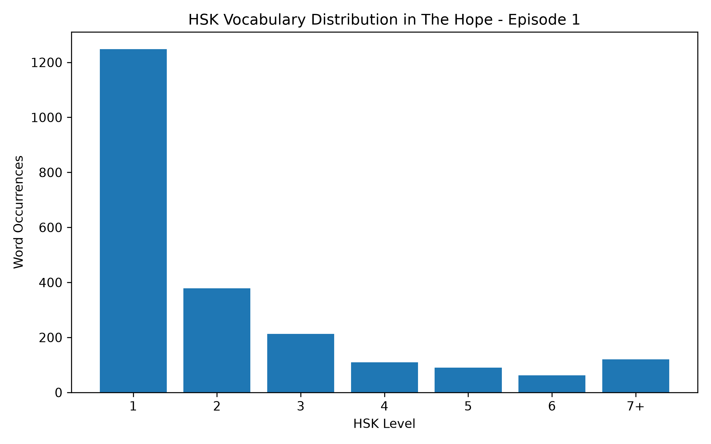
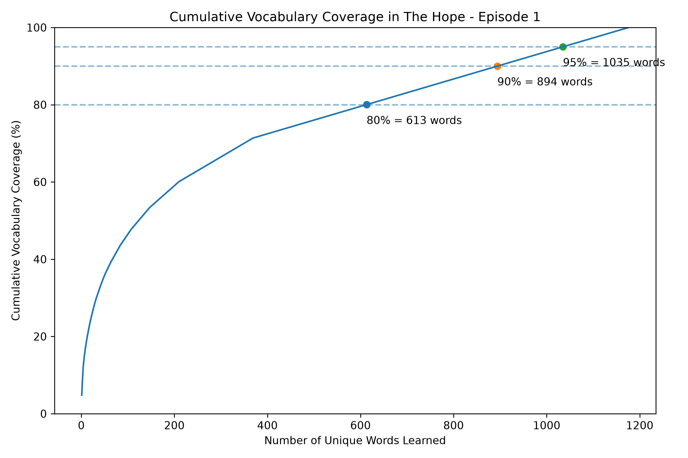

# Chinese Subtitle Vocabulary Analyzer

A data analysis project that examines vocabulary usage in a Chinese-language TV drama episode using **JavaScript, MySQL, SQL, Python, pandas, and Matplotlib**.

The project parses subtitle data from an `.srt` file, tokenizes the Chinese text into words, stores each word occurrence in MySQL, assigns HSK levels where available, and analyzes vocabulary frequency, difficulty, and coverage.

## Project Overview

This project analyzes Episode 1 of *The Hope* and answers questions such as:
- How many total and unique words appear in the episode?
- Which words appear most frequently?
- How is the vocabulary distributed across HSK levels?
- What is the frequency-weighted average HSK level?
- How much of the dialogue is covered by the most frequent vocabulary?
- How many words are needed to reach 80%, 90%, and 95% vocabulary coverage?
- How many words appear only once?

## Current Results

For Episode 1:
- **271** subtitle lines
- **2,820** total word occurrences
- **1,177** unique words
- **41.74%** vocabulary richness

### Most Frequent Words

| Word | Frequency |
| --- | ---: |
| 的 | 135 |
| 你 | 79 |
| 我 | 62 |
| 了 | 61 |
| 就 | 33 |
| 啊 | 33 |
| 是 | 30 |
| 来 | 26 |
| 我们 | 24 |
| 有 | 22 |

### Vocabulary Coverage

- **613 words** account for approximately **80%** of all word occurrences
- **894 words** account for approximately **90%**
- **1,035 words** account for approximately **95%**
- **1,177 words** account for essentially **100%**

The coverage curve shows a long-tail pattern: a core set of frequently repeated words accounts for most of the dialogue, while many less frequent words contribute only small increases in overall coverage.

## Visualizations

### HSK Vocabulary Distribution

Shows the number of word occurrences assigned to each HSK level.



### Cumulative Vocabulary Coverage

Shows how cumulative dialogue coverage increases as progressively less frequent vocabulary is added.



## Technologies Used

- **JavaScript / Node.js** — subtitle parsing, tokenization, and database loading
- **MySQL** — relational data storage
- **SQL** — aggregation, CTEs, window functions, ranking, and cumulative analysis
- **Python** — chart generation
- **pandas** — loading SQL query results into DataFrames
- **Matplotlib** — static data visualizations
- **dotenv** — environment variable management
- **segmentit** — Chinese word segmentation
- **subtitle** — `.srt` subtitle parsing

## Database Schema

The project uses two tables.

### `Subtitles`

| Column | Type | Description |
| --- | --- | --- |
| `line_id` | INT | Primary key |
| `start_time` | INT | Subtitle start time |
| `end_time` | INT | Subtitle end time |
| `subtitle_text` | TEXT | Subtitle text |

### `Words`

| Column | Type | Description |
| --- | --- | --- |
| `word_id` | INT | Primary key |
| `line_id` | INT | Foreign key referencing `Subtitles` |
| `word` | VARCHAR(100) | Tokenized Chinese word |
| `hsk_level` | INT | HSK level when available |

Each occurrence of a word is stored as its own row in `Words`, so word frequency can be calculated directly with SQL.

## Data Pipeline

```text
Raw .srt subtitle file
        ↓
Parse subtitles with JavaScript
        ↓
Save processed subtitle data as JSON
        ↓
Load subtitle lines into MySQL
        ↓
Segment Chinese subtitle text into words
        ↓
Load word occurrences into MySQL
        ↓
Assign HSK levels using reference data
        ↓
Run SQL analysis
        ↓
Load query results into pandas
        ↓
Generate Matplotlib visualizations
```

## Repository Structure

```text
.
├── data/
│   ├── raw/
│   ├── processed/
│   └── reference/
├── scripts/
│   ├── parseSubtitles.js
│   ├── loadDatabase.js
│   ├── loadWords.js
│   ├── loadHskLevels.js
│   └── createCharts.py
├── sql/
│   ├── schema.sql
│   └── analysis.sql
├── visualizations/
│   ├── hsk_distribution.png
│   └── vocabulary_coverage.png
├── .env.example
├── .gitignore
├── package.json
├── package-lock.json
└── README.md
```

## SQL Analysis

The current SQL analysis includes:

- Total word count
- Unique word count
- Vocabulary richness
- Top 20 most frequent words
- HSK-level word counts
- Percentage of classified vocabulary by HSK level
- Frequency-weighted average HSK level
- Average subtitle duration
- Longest subtitle lines
- Singleton vocabulary
- Cumulative vocabulary coverage
- Number of words required for 80%, 90%, and 95% coverage

The coverage analysis uses SQL window functions to rank words by frequency and calculate cumulative coverage.

```sql
ROW_NUMBER() OVER (
    ORDER BY frequency DESC
)
```
```sql
SUM(frequency) OVER (
    ORDER BY frequency DESC
    ROWS BETWEEN UNBOUNDED PRECEDING AND CURRENT ROW
)
```

## Setup

### 1. Clone the repository

```bash
git clone <your-repository-url>
cd <your-repository-name>
```

### 2. Install Node.js dependencies

```bash
npm install
```

### 3. Install Python dependencies

```bash
pip install pandas matplotlib mysql-connector-python python-dotenv
```

### 4. Configure environment variables

Create a `.env` file based on `.env.example`:
```env
DB_HOST=localhost
DB_USER=root
DB_PASSWORD=your_password
DB_NAME=subtitle_analyzer
```

### 5. Create the database

Run `sql/schema.sql` in MySQL Workbench or from the MySQL command line.

### 6. Run the data pipeline

```bash
node scripts/parseSubtitles.js
node scripts/loadDatabase.js
node scripts/loadWords.js
node scripts/loadHskLevels.js
```

### 7. Run the SQL analysis

Execute `sql/analysis.sql` in MySQL Workbench or from the MySQL command line.

### 8. Generate the charts

```bash
python3 scripts/createCharts.py
```
The generated PNG files are saved in the `visualizations/` directory.
